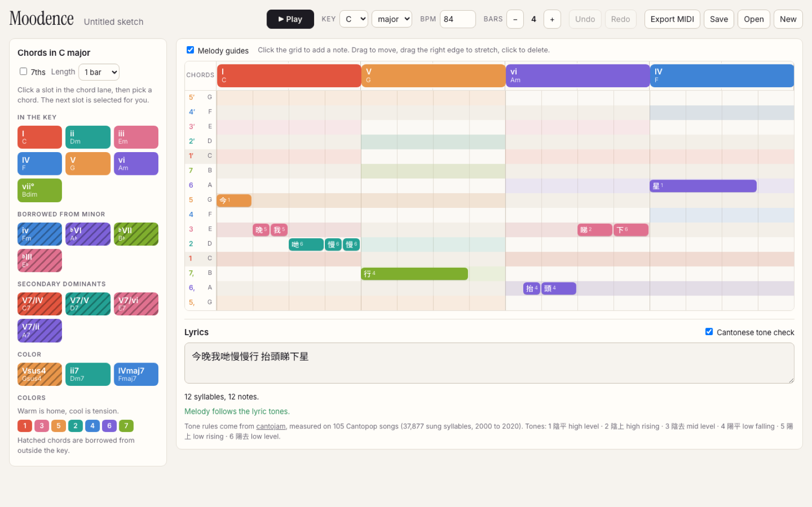
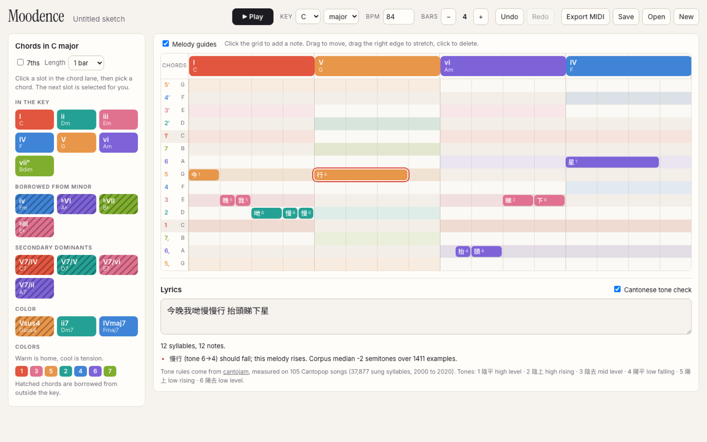
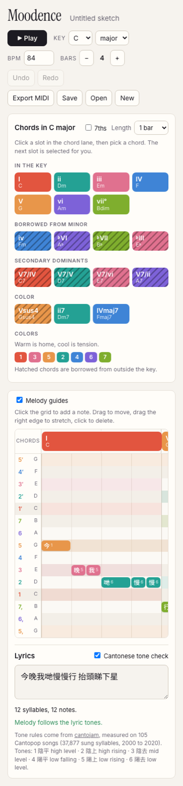
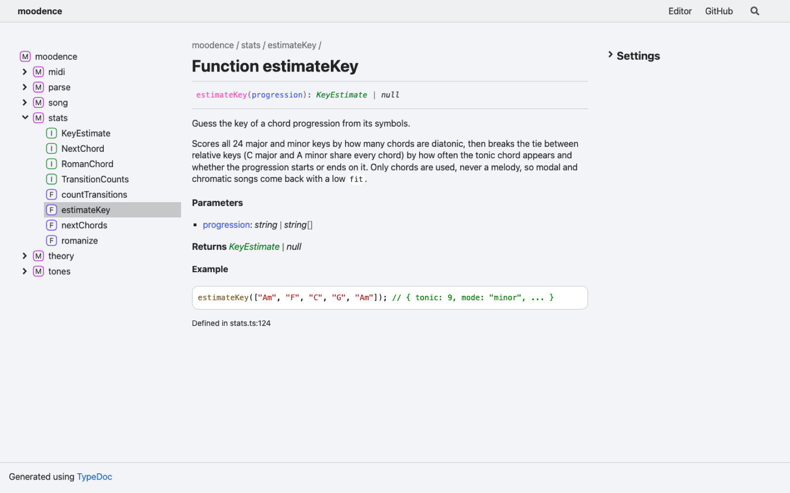

<h1 align="center">Moodence</h1>

<p align="center">
  <!-- Candy: one-line description goes here. -->
</p>

<p align="center">
  <a href="https://github.com/candpixie/moodence/actions/workflows/ci.yml"></a>
  <a href="https://candpixie.github.io/moodence/"></a>
  <a href="https://candpixie.github.io/moodence/docs/"></a>
  <a href="LICENSE"></a>
  
</p>

<p align="center">
  <a href="#quick-start">Quick start</a> ·
  <a href="#gallery">Gallery</a> ·
  <a href="#library">Library</a> ·
  <a href="#editor">Editor</a> ·
  <a href="#examples">Examples</a> ·
  <a href="#data">Data</a> ·
  <a href="#limits">Limits</a> ·
  <a href="#citing">Citing</a> ·
  <a href="CONTRIBUTING.md">Contributing</a>
</p>

<!-- Candy: why this exists, in your words. -->

## Quick start

Open the editor: **https://candpixie.github.io/moodence/**

Use the library:

```js
import { estimateKey, romanize, checkTones } from "moodence";

const key = estimateKey("Am F C G");                   // { tonic: 9, mode: "minor", fit: 1, ... }
romanize("Am F C G", key.tonic, key.mode)              // i VI III VII
  .map((c) => c.roman);
checkTones("慢慢行", [62, 62, 67]).violations;          // 行 should fall, the melody rises
```

Work on it:

```sh
git clone https://github.com/candpixie/moodence && cd moodence
pnpm install
pnpm dev        # editor at http://localhost:4391
pnpm test       # library + editor tests
pnpm examples   # runs every script in examples/
```

## Gallery

| | |
|---|---|
|  |  |
| Starter song in C major, melody guides on | 行 moved up: tone 6 to 4 should fall, so it is flagged with the corpus evidence |
|  |  |
| Phone width | Generated API reference |

## Library

`packages/moodence`, published as `moodence`. One ES module, no runtime dependencies, works in Node 18+ and browsers. [API reference](https://candpixie.github.io/moodence/docs/).

| Module | Functions |
|---|---|
| `theory` | `diatonicQuality`, `chordPitchClasses`, `chordMidi`, `romanLabel`, `chordSymbol`, `spellDegree`, `degreeMidi`, `palette` |
| `parse` | `parseChordSymbol`, `parseRoman` (incl. `V7/vi`, `vii°7/V`), `romanFromSymbol`, `splitProgression` |
| `stats` | `estimateKey`, `romanize`, `countTransitions`, `nextChords` |
| `tones` | `syllabify`, `checkTones`, `alignLyrics`, `suggestLyricFixes`, `applyLyricFix` (Cantonese, from cantojam) |
| `transpose` | `transpose` (songs, no octave jumps), `transposeProgression` (chord sheets, re-spelled by key), `capoShapes`, `soundingChords` |
| `feel` | `chordFeel` (a feel word per chord), `commonNext` (hand-written next-chord hints), `STARTERS` (progressions per mode) |
| `midi` | `songToMidi` (melody + chord tracks, lyric meta events) |
| `song` | The editor's JSON song model and editing helpers |

Conventions: pitch classes are `0..11` with C = 0. Chords are stored relative to a key (`{ deg, acc, quality }`), so `quality: null` means "whatever the key gives this degree". Chord names are spelled by letter: ♭VI in C is A♭, never G♯. Anything that does not parse comes back `null` instead of a guess.

## Editor

`app/`, a Vite + React app built on the library.

- Melody and chords in scale degrees. Changing the key, or ▼/▲ (`[` / `]`), transposes everything.
- Capo setting: chord names switch to the shapes to play, the sound stays the same.
- Chord palette per key: diatonic, borrowed from the parallel mode, secondary dominants, sus and 7th colors.
- Each chord shows a feel word (home, lifting, wants home). Hover plays the move from the previous chord. Common next chords are outlined, the rest fade but stay clickable.
- Starter progressions per mode drop in at the current spot as normal, editable chords.
- Degree colors by stability: 1, 3, 5 warm, 2, 4, 6, 7 cool. Borrowed chords are hatched.
- Melody guides tint the rows that are chord tones under each chord.
- Lyrics land one syllable per note. Cantonese lines are checked against the melody, and clashes get corpus words that fit the notes (cantojam's word finder).
- Sampled piano playback (synth fallback offline), undo/redo, MIDI export with lyrics, `.json` save/open, autosave.

## Examples

Every script in [`examples/`](examples) runs in CI.

| Script | Shows |
|---|---|
| `01-romanize.mjs` | Key estimation and Roman numerals for a few progressions |
| `02-tone-check.mjs` | A melody that follows a Cantonese lyric's tones, and one that does not |
| `03-export-midi.mjs` | Building a song from Roman numerals and writing a `.mid` |
| `04-chordonomicon.mjs` | Next-chord statistics over the Chordonomicon dataset, optionally by genre |
| `05-transpose-capo.mjs` | Transposing a chord sheet, and capo shapes vs. sounding chords |

Output of `04-chordonomicon.mjs` on the full dataset (679,807 songs; 511,623 with key fit ≥ 0.8; 98.1% of chords parsed):

```
I    -> V 33%, IV 32%, vi 13%, ii 6%, iii 5%
IV   -> I 52%, V 28%, vi 7%, ii 4%, iii 2%
V    -> I 41%, IV 23%, vi 13%, i 6%, ii 5%
vi   -> IV 39%, V 26%, I 16%, ii 7%, iii 6%
```

## Data

| Source | Used for | License | In this repo |
|---|---|---|---|
| [Cantopop corpus](https://github.com/jasonleeubc/Cantopop-corpus) (Jason Lee), via [CantoJam](https://github.com/candpixie/CantoJam) | Tone-melody rules, word finder | CC BY 4.0 | Bundled into the library build from the `cantojam` package |
| [Chordonomicon](https://huggingface.co/datasets/ailsntua/Chordonomicon) | Example 04 | CC BY-NC 4.0 | No. Download it yourself. Results derived from it are non-commercial. |
| Salamander Grand Piano | Editor playback | CC BY 3.0 | No. Streamed from the Tone.js CDN. |

Contributed songs may include chords, melody and jyutping or tone numbers. Full lyric text of commercial songs is not stored here.

## Limits

- Cantopop chord data barely exists yet. Chordonomicon tags 41 of its 679,807 songs as Cantopop, and the Cantopop corpus has melody, lyrics and jyutping but no chords.
- The tone model comes from 105 songs (2000 to 2020), mostly ballads in written Cantonese. Colloquial and post-2020 styles are under-represented.
- `estimateKey` reads chords only. It knows major, natural minor and Dorian. Other modes and chromatic songs get a low `fit`, and keys that share chords (C major, A minor, D Dorian) can swap when a song rarely lands on its tonic. A loop like Bm E A F♯m that never returns to Bm comes back as F♯ minor, even if your ear says B.
- Minor is natural minor. A major V in minor is treated as borrowed in the editor, but counts as in-key for key estimation.
- Not built: mood labels, next-chord suggestions inside the editor, Web MIDI input, a Mandarin tone mode.

## Citing

See [`CITATION.cff`](CITATION.cff), or use "Cite this repository" on GitHub. If you use the tone check, also cite the Cantopop corpus (see [ATTRIBUTION.md](ATTRIBUTION.md)).

## License

Code: [MIT](LICENSE). The Cantopop-derived data bundled from cantojam is CC BY 4.0. Details in [ATTRIBUTION.md](ATTRIBUTION.md).
